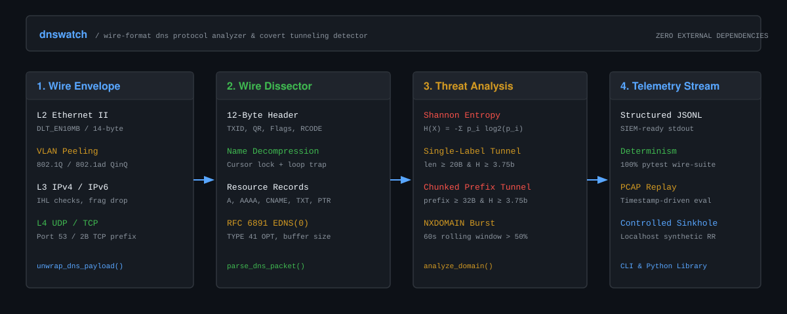
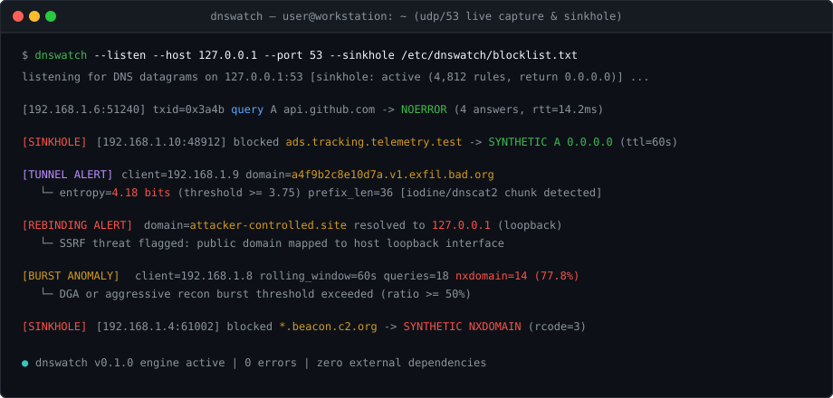
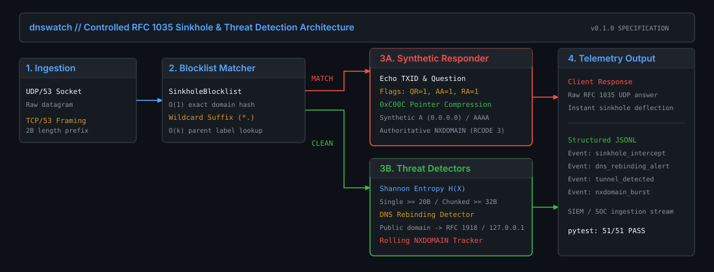

# dnswatch — Wire-Format DNS Protocol Dissector, Covert Tunneling Detector & Sinkhole

A zero-dependency passive Domain Name System (DNS) packet dissector, covert tunneling detector, DNS rebinding analyzer, and controlled RFC 1035 sinkhole responder written strictly for Python 3.10+ standard library.



---

## OVERVIEW

`dnswatch` passively inspects and analyzes raw DNS wire datagrams across `UDP/53` and length-prefixed `TCP/53`. It decapsulates raw network frames (Ethernet II, 802.1Q and 802.1ad QinQ VLAN tags, IPv4 with fragment detection, and IPv6 with extension header traversal), unpacks RFC 1035 wire structures, resolves compressed domain names with circular pointer protection, inspects RFC 6891 EDNS(0) pseudo-records, evaluates covert data exfiltration via mathematical Shannon entropy, detects Server-Side Request Forgery (SSRF) DNS rebinding attacks, and deploys a lightweight in-memory RFC 1035 sinkhole responder for controlled lab isolation.



### Core Capabilities

- **Zero-Dependency Architecture:** All packet dissectors, mathematical entropy engines, blocklist matchers, and synthetic response generators run entirely in pure Python standard library (`struct`, `socket`, `ipaddress`, `math`, `time`). Zero third-party runtime dependencies, zero C wrappers, zero external resolver lookups.
- **Envelope Decapsulation & VLAN Peeling:** Strips Layer 2 Ethernet framing, decapsulates single (802.1Q) and double (802.1ad QinQ) VLAN tags, handles IPv4 headers with IHL verification and fragmentation drop semantics, traverses IPv6 extension headers (Hop-by-Hop, Routing, Fragment, Destination Options, AH), and decapsulates UDP and length-prefixed TCP frames.
- **RFC 1035 §4.1.4 Pointer Safety:** Full domain name decompression featuring cursor lock. On the initial pointer encounter (`0xC000 | offset`), the return cursor is locked to prevent stream desynchronization. Circular pointer loops (`0xC0 0x0C` / `0xC0 0x1E`) are intercepted by a visited offset hash table and capped at a 16-hop ceiling.
- **Resource Record Decoding:** Dissects Answer, Authority, and Additional sections across 10 core types: `A` (RFC 1035), `AAAA` (RFC 3596), `CNAME`, `PTR`, `NS`, `MX`, `SOA`, `SRV`, `TXT` (single and multi-chunk character-strings), and `OPT` (RFC 6891).
- **RFC 6891 EDNS(0) OPT Pseudo-Record Parsing:** Extracts requestor UDP payload size (`CLASS`), extended RCODE, EDNS version, DNSSEC OK (`DO`) bit, and option attributes (`TYPE 41`). Flags oversized payload buffers ($\ge 4096\text{B}$) paired with `ANY`/`TXT` queries as DNS amplification candidates.
- **Shannon Entropy Tunneling Detector:** Computes normalized mathematical Shannon entropy $H(X) = -\sum p_i \log_2(p_i)$ over lowercase character distributions. Flags data exfiltration across single long labels ($\ge 20\text{B}$, $H \ge 3.75$) and chunked multi-label subdomain prefixes ($\ge 32\text{B}$, $H \ge 3.75$) to unmask `iodine`, `dnscat2`, and Base32/Base64/hex tunneling.
- **DNS Rebinding (SSRF) Anomaly Detection:** Inspects resolved `A` and `AAAA` responses to identify public hostnames mapping to RFC 1918 private IPv4 (`10.0.0.0/8`, `172.16.0.0/12`, `192.168.0.0/16`), loopback (`127.0.0.0/8`), link-local (`169.254.0.0/16`), Carrier-Grade NAT (`100.64.0.0/10`), or IPv6 loopback (`::1`) and ULA (`fc00::/7`). Automatically exempts standard internal namespaces (`.local`, `.lan`, `.internal`, `.home.arpa`, `localhost`).
- **Rolling-Window NXDOMAIN Burst Tracker:** Stateful 60-second sliding-window tracker per client IP. Flags Domain Generation Algorithm (DGA) malware beaconing and brute-force enumeration when query volume $\ge 10$ and failure ratio $\ge 50\%$.
- **Controlled RFC 1035 Sinkhole Responder:** In-memory blocklist engine with $O(1)$ exact domain matching and $O(k)$ parent label wildcard lookups (`*.malware.test`). Directly synthesizes raw wire-format responses echoing query transaction IDs and question sections, packing synthetic `A` (`0.0.0.0`), `AAAA` (`::`), or authoritative `NXDOMAIN` (RCODE 3) with compliant `0xC00C` pointer compression.

---

## ARCHITECTURE & PIPELINE



```text
dnswatch/
├── __init__.py         # Public exports (parsers, models, entropy, tracker, sinkhole, rebinding)
├── constants.py        # RFC 1035 / RFC 6891 wire constants, types, classes, and rcodes
├── models.py           # Immutable dataclasses (DNSHeader, DNSPacket, DNSResourceRecord, EDNS0Option)
├── parser.py           # Wire unpacker, name decompression, bounds checks, and JSONL serializer
├── envelope.py         # L2/L3/L4 decapsulation, 802.1Q/ad VLAN peeling, fragment detection
├── entropy.py          # Shannon entropy calculator and single/chunked tunneling detectors
├── tracker.py          # Rolling 60-second sliding-window NXDOMAIN burst tracker
├── rebinding.py        # SSRF DNS rebinding anomaly detector and IP classification
├── responder.py        # Zero-dependency RFC 1035 synthetic response builder (0xC00C compression)
├── sinkhole.py         # In-memory domain blocklist matcher (exact, wildcard, hosts file)
└── cli.py              # Interactive UDP listener, sinkhole responder, and JSONL stream CLI
```

---

## WIRE PROTOCOL SPECIFICATION

### Fixed 12-Byte Header Format (RFC 1035 §4.1.1)

```text
 0                   1                   2                   3
 0 1 2 3 4 5 6 7 8 9 0 1 2 3 4 5 6 7 8 9 0 1 2 3 4 5 6 7 8 9 0 1
+-+-+-+-+-+-+-+-+-+-+-+-+-+-+-+-+-+-+-+-+-+-+-+-+-+-+-+-+-+-+-+-+
|                      Transaction ID (16)                      |
+-+-+-+-+-+-+-+-+-+-+-+-+-+-+-+-+-+-+-+-+-+-+-+-+-+-+-+-+-+-+-+-+
|QR|   Opcode  |AA|TC|RD|RA| Z  | RCODE |                    |
+-+-+-+-+-+-+-+-+-+-+-+-+-+-+-+-+-+-+-+-+-+-+-+-+-+-+-+-+-+-+-+-+
|                    Question Count (QDCOUNT)                   |
+-+-+-+-+-+-+-+-+-+-+-+-+-+-+-+-+-+-+-+-+-+-+-+-+-+-+-+-+-+-+-+-+
|                     Answer Count (ANCOUNT)                    |
+-+-+-+-+-+-+-+-+-+-+-+-+-+-+-+-+-+-+-+-+-+-+-+-+-+-+-+-+-+-+-+-+
|                   Authority Count (NSCOUNT)                   |
+-+-+-+-+-+-+-+-+-+-+-+-+-+-+-+-+-+-+-+-+-+-+-+-+-+-+-+-+-+-+-+-+
|                  Additional Count (ARCOUNT)                   |
+-+-+-+-+-+-+-+-+-+-+-+-+-+-+-+-+-+-+-+-+-+-+-+-+-+-+-+-+-+-+-+-+
```

### Invariant Defenses & Edge Cases

| Attack / Edge Case | Invariant Rule | Defense Mechanism |
| :--- | :--- | :--- |
| **Compression Pointer Loop** | Visited offset set tracking | Maximum 16 hops; loops raise `ValueError("Compression pointer loop or out-of-bounds offset")`. |
| **Pointer Desynchronization** | Cursor lock on first jump | Locks `next_offset = offset + 2` on initial pointer encounter (`jumped = False`). |
| **Non-Initial IPv4 Fragments** | Fragment offset $> 0$ | Flagged as `is_fragment=True`; L4 parsing bypassed to protect against fragment confusion. |
| **IPv6 Extension Chaining** | Next header traversal | Bounded extension header parser supporting Hop-by-Hop, Routing, AH, and Destination Options. |
| **TCP Stream Framing** | RFC 1035 §4.2.2 2-byte prefix | Extracts 2-byte big-endian message length prefix before dissecting stream payloads. |
| **Buffer Overflow via EDNS0** | Advertised UDP buffer size | Flags advertised payloads $\ge 4096\text{B}$ paired with `ANY`/`TXT` queries (`dns_amplification_candidate`). |
| **Single-Label Exfiltration** | Label length $\ge 20\text{B}$, $H \ge 3.75\text{b}$ | Detects Base32/Base64/hex payload channels inside isolated long labels. |
| **Multi-Label Chunked Tunnel** | Subdomain prefix $\ge 32\text{B}$, $H \ge 3.75\text{b}$ | Concatenates subdomains to catch chunked exfiltration (`iodine`, `dnscat2`). |
| **DNS Rebinding (SSRF)** | Public domain $\rightarrow$ Private IP | Flags public hostnames resolving to RFC 1918, loopback, link-local, or CGNAT IP blocks. |
| **Sinkhole Blocklist Poisoning** | Case normalization & comments | Strips inline comments, leading/trailing whitespace, and trailing root dots; hashes lowercase strings. |
| **Synthetic Pointer Serialization** | Compression pointer `0xC00C` | References QNAME at fixed byte offset 12 in the Question section, eliminating byte bloat. |

---

## THREAT DETECTION ENGINES

### 1. Shannon Entropy Tunneling Detector (`entropy.py`)

Adversaries exfiltrate data or maintain C2 channels by encoding payloads into DNS query labels (e.g. `base32`, `base64`, or hexadecimal representations). Legitimate domain names exhibit character frequencies reflecting natural language morphology, whereas ciphertext and compressed data exhibit near-uniform symbol distributions with high entropy.

The normalized Shannon entropy is calculated as:

$$H(X) = -\sum_{i=1}^{n} p(x_i) \log_2 p(x_i)$$

Where $p(x_i)$ is the empirical probability of character $x_i$ occurring in the lowercase label string.

```python
from dnswatch.entropy import analyze_domain

# Normal human domain lookup
res1 = analyze_domain("api.github.com")
# res1.is_suspicious == False (entropy ~2.81 bits)

# Covert chunked DNS tunneling payload (iodine / dnscat2)
res2 = analyze_domain("a4f9b2c8e10d7a.v1.exfil.bad.org")
# res2.is_suspicious == True
# res2.reason == "chunked_prefix_tunneling_candidate"
# res2.prefix_entropy == 4.18 bits (threshold >= 3.75 bits)
```

### 2. DNS Rebinding Detector (`rebinding.py`)

DNS rebinding attacks bypass browser Same-Origin Policy (SOP) and perimeter firewalls by configuring an external authoritative name server to return a short TTL for a public domain, initially resolving to a benign public IP and subsequently resolving to an internal private IP address (e.g., `127.0.0.1` or `192.168.1.1`). This allows client-side JavaScript executing in a browser to issue unauthorized HTTP requests against local loopback daemons or router administration interfaces.

`dnswatch` traverses all resolved `A` and `AAAA` records in DNS responses, immediately raising alerts when a non-local domain maps into restricted IP space:

```python
from dnswatch.models import DNSPacket
from dnswatch.rebinding import detect_dns_rebinding

# Inspect any parsed DNSPacket
alerts = detect_dns_rebinding(packet)
for alert in alerts:
    print(f"SSRF Rebinding: {alert.domain} -> {alert.ip} ({alert.range_category})")
```

Restricted address blocks evaluated:
- `127.0.0.0/8` (Loopback)
- `10.0.0.0/8`, `172.16.0.0/12`, `192.168.0.0/16` (RFC 1918 Private)
- `169.254.0.0/16` (Link-Local)
- `100.64.0.0/10` (Carrier-Grade NAT)
- `0.0.0.0/8` (Current Network)
- `::1` (IPv6 Loopback)
- `fc00::/7` (IPv6 Unique Local Address ULA)
- `fe80::/10` (IPv6 Link-Local)

### 3. Rolling-Window NXDOMAIN Burst Tracker (`tracker.py`)

Malware leveraging Domain Generation Algorithms (DGA) programmatically queries dozens or hundreds of pseudo-random domain names per minute in search of an active Command and Control (C2) rendezvous server. Because the vast majority of DGA domains are unregistered, this activity generates a dense burst of `NXDOMAIN` (RCODE 3) responses.

`NXDOMAINTracker` maintains a stateful 60-second rolling sliding window per client IP, flagging anomalies when:
1. Total queries in the rolling 60-second window $\ge 10$.
2. Total `NXDOMAIN` responses $\ge 5$.
3. The client failure ratio $\frac{\text{NXDOMAIN}}{\text{Total Queries}} \ge 50\%$.

---

## CONTROLLED SINKHOLE ENGINE (RFC 1035)

`dnswatch` incorporates an authoritative sinkhole responder (`responder.py`) and an in-memory blocklist matcher (`sinkhole.py`) engineered for local lab environments and malware isolation cells.

```text
Raw Query (12B Header + Question)
         │
         ▼
┌────────────────────────┐
│  SinkholeBlocklist     │  O(1) Exact Match: ads.tracker.com
│  In-Memory Matcher     │  O(k) Wildcard Suffix: *.malware.test
└────────────────────────┘
         │
         ├────────────────────────────────────────┐
         │ (Matched)                              │ (Clean)
         ▼                                        ▼
┌────────────────────────┐               ┌────────────────────────┐
│ build_sinkhole_response│               │ Passive Telemetry /    │
│                        │               │ Forwarding Engine      │
│ • Echoes Query TXID    │               └────────────────────────┘
│ • QR=1, AA=1, RA=1     │
│ • Pointer: 0xC00C      │
│ • Synthetic A 0.0.0.0  │
│   or NXDOMAIN (RCODE 3)│
└────────────────────────┘
```

### Pointer Compression Mechanics (`0xC00C`)

Rather than re-encoding the queried domain name string into the Answer section, `build_sinkhole_response` compresses the Answer name by pointing back to byte offset 12 in the Question section using an RFC 1035 compression pointer:

```text
Byte Offset:   12 (0x000C)
               ┌──┬─────────┬──┬─────────┬──┬─────┬──┐
Question QNAME:│03│ a p i   │06│ g i t h │03│ c o │00│
               └──┴─────────┴──┴─────────┴──┴─────┴──┘
                      ▲
                      │ Pointer reference: 0xC000 | 12 = 0xC00C
               ┌──────┴──┐
Answer NAME:   │ C0 │ 0C │ TYPE: 0x0001 (A) | CLASS: 0x0001 (IN) | TTL: 60s
               └─────────┘
```

### Supported Blocklist Formats

`SinkholeBlocklist` accepts plain text domain lists, wildcard expressions, and standard Unix hosts-file layouts:

```text
# Plain text exact domains
ads.example.com
telemetry.tracking.bad

# Wildcard domain expressions (matches base domain and all subdomains)
*.malware.test
*.c2-beacon.org

# Standard hosts-file format (loopback prefixes stripped automatically)
0.0.0.0 adserver.network.com
127.0.0.1 metrics.badactor.io
::1 ipv6.threat.net
```

---

## BUILD, INSTALL & TESTING

### Requirements

- Python 3.10+ (Standard Library only; no external package dependencies)
- Operating Systems: Linux, FreeBSD, OpenBSD, macOS, Windows 10/11

### Local Installation

Clone the repository and install using `pip`:

```bash
git clone https://github.com/netequator/dnswatch.git
cd dnswatch

# Editable developer installation
pip install -e .
```

### Verification & Test Suite

Run the full deterministic unit test suite with `pytest`:

```bash
# Execute all 51 tests
pytest tests/ -v

# Run strict code quality and formatting checks
ruff check .
```

Test coverage breakdown:
- `test_parser.py`: 18 tests (RFC 1035 headers, label decoding, pointer cursor lock, loop traps, hop limits, RR types A/AAAA/CNAME/PTR/TXT/OPT, JSONL serialization).
- `test_envelope.py`: 10 tests (Ethernet framing, 802.1Q single VLAN, 802.1ad QinQ double VLAN, IPv4 fragmentation, IPv6 extension headers, TCP framing, raw IP).
- `test_entropy.py`: 5 tests (Shannon entropy mathematical boundaries, benign domains, single-label tunnels, chunked multi-label prefixes, root labels).
- `test_tracker.py`: 3 tests (NXDOMAIN thresholds, sliding-window expiry, burst anomaly detection).
- `test_responder.py`: 6 tests (Synthetic A responses, custom sink IPs, AAAA responses, NXDOMAIN generation, bounds checks, zero-question errors).
- `test_sinkhole.py`: 5 tests (Exact matching, wildcard matching, hosts-file ingestion, comments/whitespace handling, error states).
- `test_rebinding.py`: 4 tests (Private IP classification, local domain exemption, SSRF rebinding alerts, custom allowlists).

Total: **51 passed** (100% passing in < 0.4s).

---

## USAGE & CLI REFERENCE

### Command-Line Interface

`dnswatch` installs a standalone executable entrypoint (`dnswatch`):

```bash
# Start passive UDP listener on port 5353
dnswatch --listen --port 5353

# Run on standard DNS port 53 with sinkhole blocklist active (requires sudo on Linux)
dnswatch --listen --host 127.0.0.1 --port 53 --sinkhole /etc/dnswatch/blocklist.txt

# Return custom sinkhole IP address (e.g., local honeypot at 10.0.0.5)
dnswatch --listen --port 53 --sinkhole blocklist.txt --sink-ip 10.0.0.5

# Return authoritative NXDOMAIN instead of synthetic A records for blocked queries
dnswatch --listen --port 53 --sinkhole blocklist.txt --sink-mode nxdomain

# Stream normalized JSONL events to stdout (pipeable to jq, grep, or vector agents)
dnswatch --listen --port 53 --jsonl
```

### CLI Flag Reference

| Flag | Type | Default | Description |
| :--- | :--- | :--- | :--- |
| `--listen` | Flag | `False` | Start interactive UDP socket listener. |
| `--host` | String | `127.0.0.1` | Local IP address to bind socket listener. |
| `--port` | Integer | `5353` | UDP port to bind socket listener (`53` for production DNS). |
| `--sinkhole` | Path | `None` | Path to flat text or hosts-format blocklist file. |
| `--sink-ip` | String | `0.0.0.0` | Synthetic IPv4 address returned for blocked A queries. |
| `--sink-mode` | Choice | `a` | Sinkhole response mode (`a` for synthetic IP, `nxdomain` for RCODE 3). |
| `--no-rebinding`| Flag | `False` | Disable real-time DNS rebinding (SSRF) anomaly detection. |
| `--jsonl` | Flag | `False` | Emit machine-readable normalized JSONL event stream to stdout. |

---

## PROGRAMMATIC PYTHON API

### 1. Parsing Raw Wire Datagrams

```python
from dnswatch.parser import parse_dns_packet

raw_datagram = b"\x13\x37\x01\x00\x00\x01\x00\x00\x00\x00\x00\x00\x06google\x03com\x00\x00\x01\x00\x01"

packet = parse_dns_packet(raw_datagram)
print(f"TXID: 0x{packet.header.txid:04x}")
print(f"Type: {packet.questions[0].qtype_name} Domain: {packet.questions[0].name}")
```

### 2. Envelope Decapsulation & VLAN Peeling

```python
from dnswatch.envelope import unwrap_dns_payload

# Raw Ethernet frame captured from socket or PCAP
frame_bytes = b"..." 

envelope = unwrap_dns_payload(frame_bytes, dns_only=True)
if envelope:
    print(f"Proto: {envelope.proto} | {envelope.src_ip}:{envelope.src_port} -> {envelope.dst_ip}:{envelope.dst_port}")
    if envelope.vlan_tags:
        print(f"VLAN IDs peeled: {envelope.vlan_tags}")
```

### 3. Evaluating DNS Rebinding & Tunneling

```python
from dnswatch.entropy import analyze_domain
from dnswatch.rebinding import detect_dns_rebinding

# Tunneling evaluation
entropy_result = analyze_domain("x1f89c20a4b87e21a009.tunnel.evil.org")
if entropy_result.is_suspicious:
    print(f"Tunnel detected! Entropy={entropy_result.prefix_entropy:.2f} bits")

# Rebinding evaluation
rebinding_alerts = detect_dns_rebinding(parsed_packet)
for alert in rebinding_alerts:
    print(f"SSRF Rebinding Alert: {alert.domain} -> {alert.ip} ({alert.range_category})")
```

### 4. Synthesizing RFC 1035 Sinkhole Answers

```python
from dnswatch.constants import RCODE_NOERROR, RCODE_NXDOMAIN
from dnswatch.responder import build_sinkhole_response
from dnswatch.sinkhole import SinkholeBlocklist

# Initialize blocklist
blocklist = SinkholeBlocklist()
blocklist.add("*.malware.test")
blocklist.add("ads.tracking.com")

query_bytes = b"..." # Incoming UDP query

domain_under_query = "c2.malware.test"
if blocklist.is_blocked(domain_under_query):
    # Synthesize A record returning 0.0.0.0
    sink_response = build_sinkhole_response(query_bytes, sink_ip="0.0.0.0", ttl=60)
    # Or synthesize NXDOMAIN
    nx_response = build_sinkhole_response(query_bytes, rcode=RCODE_NXDOMAIN)
```

---

## TELEMETRY EVENT SCHEMA (JSONL)

When executed with `--jsonl`, `dnswatch` emits newline-delimited JSON events designed for SOC pipelines, Fluentd, Logstash, or SIEM ingestion.

### Standard DNS Transaction Event

```json
{
  "timestamp": 1795210200.142,
  "header": {
    "txid": 14923,
    "qr": "query",
    "opcode": 0,
    "aa": false,
    "tc": false,
    "rd": true,
    "ra": false,
    "rcode": "NOERROR",
    "qdcount": 1,
    "ancount": 0
  },
  "questions": [
    {
      "name": "api.github.com",
      "qtype": 1,
      "qtype_name": "A",
      "qclass": 1,
      "qclass_name": "IN"
    }
  ],
  "answers": []
}
```

### Sinkhole Interception Event

```json
{
  "timestamp": 1795210205.819,
  "event": "sinkhole_intercepted",
  "client": "192.168.1.10:48912",
  "domain": "ads.tracking.telemetry.test",
  "action": "a_0.0.0.0"
}
```

### DNS Rebinding Anomaly Alert

```json
{
  "timestamp": 1795210212.441,
  "event": "dns_rebinding_alert",
  "domain": "attacker-controlled.site",
  "ip": "127.0.0.1",
  "category": "loopback"
}
```

---

## LIMITATIONS & PROTOCOL BOUNDARIES

- **DNSSEC Validation:** `dnswatch` unpacks RFC 6891 `OPT` records and parses the `DO` bit, but does not cryptographically validate `RRSIG`, `DNSKEY`, or `DS` chains.
- **Encrypted DNS (DoH / DoT):** By design as a passive wire-format dissector, `dnswatch` targets plaintext `UDP/53` and `TCP/53`. Encrypted transport protocols (DNS over HTTPS / DNS over TLS) conceal wire payloads within TLS sessions.
- **Layer 2 Capture Privileges:** Binding to privileged ports (`UDP/53`) or raw socket interfaces (`AF_PACKET`) on Linux requires `CAP_NET_BIND_SERVICE` or root privileges. On Windows, Layer 2 promiscuous frame capture requires Npcap.

---

## TODO & ROADMAP

- [x] Day 1: Zero-dependency wire-format packet parser with RFC 1035 §4.1.4 pointer loop defense.
- [x] Day 2: Resource Record dissectors (`A`, `AAAA`, `CNAME`, `PTR`, `TXT`, `MX`, `SOA`, `SRV`) and RFC 6891 EDNS(0) `OPT` parsing.
- [x] Day 3: Wire envelope decapsulation (802.1Q/ad VLANs, IPv4/IPv6, UDP/TCP), Shannon entropy tunneling detection, and sliding NXDOMAIN burst tracking.
- [x] Day 4: Controlled RFC 1035 sinkhole responder, in-memory blocklist matcher, and DNS rebinding anomaly detector.
- [ ] Integration into `flowbaseline` flagship anomaly detection daemon for multi-protocol baseline profiling.

---

## LICENSE

BSD-3-Clause. Authored and maintained by the `netequator` project.
